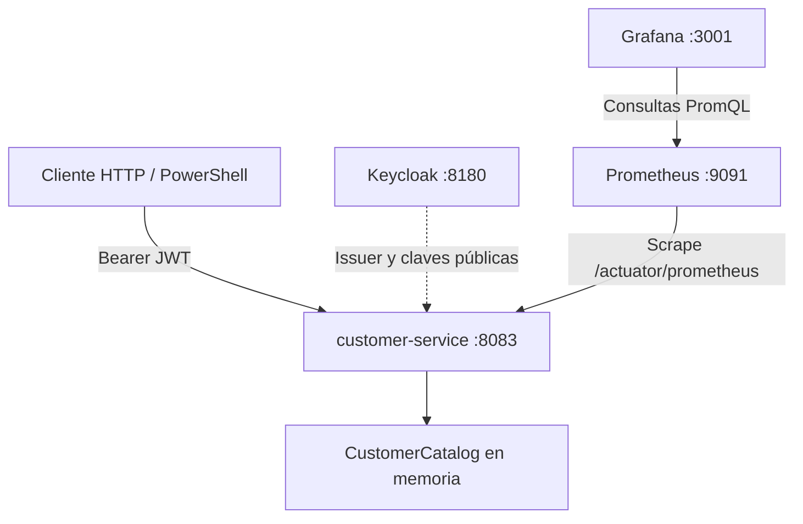

# Proyecto final — Customer Service: microservicio reactivo de clientes

**Curso:** Arquitectura de Microservicios Reactivos con Spring WebFlux  
**Modalidad:** individual o por parejas  
**Tiempo máximo:** **120 minutos**  
**Tecnologías:** Java 21, Spring Boot 4.1.2, Maven, WebFlux, Reactor, Keycloak, Spring Security JWT, Actuator, Micrometer, Prometheus y Grafana.  
**Ambiente:** Windows 11, VS Code/IDE de preferencia, PowerShell y Docker Desktop.

> **Consigna:** desarrollar un microservicio autónomo `customer-service` a partir del *starter* proporcionado. No utilizar WebClient, bases de datos, API Gateway, retry, circuit breakers ni bibliotecas adicionales para integrar microservicios. El instructor proporciona la infraestructura de autenticación y monitoreo lista para iniciar. **El starter no incluye la solución funcional.**

## 1. Escenario empresarial

NeoBank requiere un servicio especializado para administrar clientes. Los servicios de cuentas y transacciones construidos durante el curso siguen operando de manera independiente, pero **no participan en este reto**. El nuevo equipo debe entregar una API reactiva segura, validar solicitudes y exponer métricas operativas que puedan consultarse en Grafana.

La aplicación atenderá tráfico HTTP en el **puerto 8083**. No compartirá datos ni hará llamadas a otros microservicios.



## 2. Insumos que proporciona el instructor

El ZIP `Proyecto_Final_Customer_Service_Starter.zip` contiene:

- Proyecto Maven de **un solo módulo** con todas las dependencias principales declaradas en `pom.xml`.
- Clase de arranque `CustomerServiceApplication` y configuración `application.yml` (puerto 8083, JWT y Actuator).
- `SecurityConfig.java` de **arranque**, con protección genérica JWT y acceso técnico a Actuator. El alumno debe completar las reglas de autorización por roles de cliente.
- Estructura de paquetes y marcadores de tareas. **No contiene controladores, modelo de negocio ni catálogo implementados**.
- `docker-compose.yml`, archivo de realm para Keycloak, configuración de Prometheus y fuente de datos de Grafana.
- `.env.example` y `README.md` con comandos de arranque.

**Puertos del proyecto final (evitan conflictos con los Labs 3 y 4):**

| Componente | Puerto en Windows | Alcance |
|---|---:|---|
| Customer Service | 8083 | Proceso Java del alumno |
| Keycloak | 8180 | Contenedor para este proyecto |
| Prometheus | 9091 | Contenedor para este proyecto |
| Grafana | 3001 | Contenedor para este proyecto |

> El uso de `host.docker.internal:8083` en Prometheus es intencional: Docker Desktop debe poder consultar el servicio Java que se ejecuta en Windows. La URL `http://prometheus:9090` es interna entre contenedores y se utiliza desde Grafana.

## 3. Contrato funcional que debe implementar el alumno

**Modelo de dominio:** `Customer` con campos `UUID id`, `String name`, `String email`.

- `id`: generado por el servidor en cada creación.
- `name`: obligatorio, no debe quedar vacío después de recortar espacios.
- `email`: obligatorio y con formato básico válido.
- Persistencia: `ConcurrentHashMap<UUID, Customer>` en memoria. No se exige persistir después de un reinicio.

| Método | Ruta | Resultado válido | Tipo reactivo esperado |
|---|---|---|---|
| GET | `/api/customers` | `200 OK`, arreglo JSON; `[]` cuando está vacío | `Flux<Customer>` |
| GET | `/api/customers/{id}` | `200 OK` o `404 Not Found` | `Mono<Customer>` |
| GET | `/api/customers?id={id}` | Consulta por ID, alternativa a `/{id}`; requiere un UUID completo | `Mono<Customer>` |
| POST | `/api/customers` | `201 Created`, cliente con ID generado | `Mono<Customer>` o `Mono<ResponseEntity<Customer>>` |
| PUT | `/api/customers/{id}` | `200 OK` o `404 Not Found` | `Mono<Customer>` |
| DELETE | `/api/customers/{id}` | `204 No Content` o `404 Not Found` | `Mono<Void>` o `Mono<ResponseEntity<Void>>` |

**Ejemplo de POST:**

```json
{"name":"Ana Torres","email":"ana.torres@example.test"}
```

**Ejemplo de respuesta de POST:**

```json
{"id":"22222222-2222-4222-8222-222222222222","name":"Ana Torres","email":"ana.torres@example.test"}
```

*El UUID es ilustrativo: cada ejecución generará su propio identificador.*

**Errores esperados:** `400` para cuerpo inválido, UUID mal formado o datos incompletos; `401` cuando falta o es inválido el token; `403` cuando el usuario autenticado no tiene el permiso requerido; `404` cuando no existe el cliente.

> Se evaluará que los casos de validación devuelvan el código correcto; no se exige un modelo particular de respuesta de error mientras no exponga stack traces o información sensible.

## 4. Reglas de seguridad

Realm local: `customer-final`; cliente OAuth de laboratorio: `customer-cli-lab`; audiencia del JWT: `customer-api`.

| Usuario de práctica | Roles Realm | Uso previsto |
|---|---|---|
| `customer-reader` | `CUSTOMER_READ` | Solo consultas |
| `customer-operator` | `CUSTOMER_READ`, `CUSTOMER_WRITE` | Consultas y modificaciones |

- GET `/api/customers` y `/api/customers/{id}`: permiso `CUSTOMER_READ`.
- POST, PUT y DELETE: permiso `CUSTOMER_WRITE`.
- `/actuator/health`, `/actuator/health/**` y `/actuator/prometheus`: accesibles para la recolección local de métricas.
- Todo lo demás: denegado.
- Validar **firma, emisor y audiencia** de los JWT, sin usar tokens de prueba falsos ni desactivar seguridad para completar el reto.
- Los roles llegan en `realm_access.roles`; el alumno debe convertirlos a autoridades `ROLE_CUSTOMER_READ` / `ROLE_CUSTOMER_WRITE`.

**Nota de seguridad:** el cliente OAuth usa *Direct Access Grants* (grant_type=password) exclusivamente para pruebas académicas mediante PowerShell; **no es un flujo recomendado para aplicaciones de producción**. Las contraseñas del ZIP son valores de demostración.

## 5. Plan de trabajo — 120 minutos

### Fase 0 (10 min) — Preparar infraestructura

1. Extrae el ZIP en una carpeta independiente, sin sustituir proyectos de laboratorios anteriores.
2. Abre PowerShell **en la carpeta que contiene `pom.xml` y `docker-compose.yml`**.
3. Comprueba herramientas:

   ```powershell
   java -version
   mvn -version
   docker compose version
   ```

4. Crea el archivo de variables de laboratorio y arranca la infraestructura:

   ```powershell
   Copy-Item .env.example .env
   docker compose up -d
   docker compose ps
   ```

5. Accede a Keycloak en `http://localhost:8180`, Prometheus en `http://localhost:9091` y Grafana en `http://localhost:3001`.
6. En Grafana, revisa que la fuente de datos **Prometheus** ya está provisionada. Todavía no esperes que el target de Customer Service esté `UP` si el proceso Java no se ha iniciado.

**Punto de control:** los tres contenedores están ejecutándose. Comprueba también que el realm se importó visitando:

```powershell
Invoke-RestMethod "http://localhost:8180/realms/customer-final/.well-known/openid-configuration" | Select-Object issuer
```

Si los servicios de laboratorios previos están usando otros puertos, puedes mantenerlos activos: este proyecto usa 8180, 9091 y 3001.

### Fase 1 (15 min) — Revisar estructura y crear modelo

1. Verifica `pom.xml`: contiene WebFlux, Security OAuth2 Resource Server, Validation, Actuator, Prometheus y pruebas.
2. Identifica `src/main/java/com/bancolombia/training/customers/`.
3. Crea `model/Customer.java` con los tres campos acordados. Puedes utilizar un `record` de Java 21.
4. Crea un DTO de entrada `CreateOrUpdateCustomerRequest` con `name` y `email`; aplica validación Jakarta (`@NotBlank`, `@Email`) u otra validación explícita equivalente.
5. **No agregues campo `accountId` ni WebClient**.

**Punto de control:** el modelo no depende de los otros microservicios.

### Fase 2 (20 min) — Catálogo reactivo en memoria

1. Implementa `catalog/CustomerCatalog.java` utilizando `ConcurrentHashMap<UUID, Customer>`.
2. Define operaciones para: listar, obtener por ID, crear, actualizar y eliminar.
3. Haz que las operaciones expongan `Mono` y `Flux` (puedes emplear `Mono.justOrEmpty`, `Flux.fromIterable`, `Mono.defer`).
4. No uses `.block()` ni dependas de `Thread.sleep()`.
5. En la actualización y eliminación, distingue los clientes existentes de los inexistentes.

**Punto de control:** las cinco operaciones pueden ejecutarse sobre el catálogo en memoria.

### Fase 3 (30 min) — REST y manejo de errores

1. Implementa `web/CustomerController.java` con las cinco rutas de la sección 3.
2. En POST, asigna un UUID **en el servidor** y devuelve `201`.
3. En DELETE, devuelve `204` sin cuerpo.
4. Valida los datos de POST/PUT y responde `400` ante errores de entrada.
5. Cuando no existe una entidad, devuelve `404`.
6. Compila:

   ```powershell
   mvn clean package
   ```

7. Inicia Customer Service en **otra terminal** (requiere Keycloak disponible):

   ```powershell
   mvn spring-boot:run
   ```

**Punto de control:** compila sin errores y el servicio escucha en `http://localhost:8083`.

### Fase 4 (20 min) — JWT con Keycloak

1. Abre `security/SecurityConfig.java`. El starter contiene un filtro JWT básico **sin** permisos específicos por rol.
2. Añade reglas GET/POST/PUT/DELETE tal como se define en la sección 4, y conserva las excepciones para Actuator.
3. Implementa un convertidor de roles de Keycloak. El claim `realm_access.roles` debe transformarse a `ROLE_CUSTOMER_READ` y `ROLE_CUSTOMER_WRITE`.
4. No desactives JWT ni cambies el issuer o la audiencia esperados.
5. Obtén el token de solo lectura:

   ```powershell
   $reader = (Invoke-RestMethod -Method POST `
     -Uri 'http://localhost:8180/realms/customer-final/protocol/openid-connect/token' `
     -ContentType 'application/x-www-form-urlencoded' `
     -Body @{
       grant_type = 'password'
       client_id  = 'customer-cli-lab'
       username   = 'customer-reader'
       password   = 'Reader#Final2026!'
     }).access_token
   ```

6. Obtén el token de operador:

   ```powershell
   $operator = (Invoke-RestMethod -Method POST `
     -Uri 'http://localhost:8180/realms/customer-final/protocol/openid-connect/token' `
     -ContentType 'application/x-www-form-urlencoded' `
     -Body @{
       grant_type = 'password'
       client_id  = 'customer-cli-lab'
       username   = 'customer-operator'
       password   = 'Operator#Final2026!'
     }).access_token
   ```

**Punto de control:** GET con Reader responde 200, POST con Reader responde 403 y POST con Operator responde 201. Una solicitud sin JWT devuelve 401.

### Fase 5 (10 min) — Observabilidad

1. Revisa `/actuator/health` desde PowerShell:

   ```powershell
   Invoke-RestMethod 'http://localhost:8083/actuator/health'
   ```

2. Comprueba que el endpoint de Prometheus está expuesto:

   ```powershell
   $metrics = (Invoke-WebRequest 'http://localhost:8083/actuator/prometheus').Content
   $metrics -split "`n" | Select-String 'jvm_memory_used_bytes|http_server_requests_seconds_count'
   ```

3. Abre `http://localhost:9091/targets` y comprueba que `customer-service` aparece `UP`. Un target `DOWN` obliga a revisar que Java esté escuchando en 8083 y que `host.docker.internal` funcione desde Docker Desktop.
4. Abre Grafana en `http://localhost:3001`; usa Explore para consultar:

   ```promql
   up{job="customer-service"}
   ```

5. Genera tráfico de negocio y analiza una métrica como:

   ```promql
   sum(rate(http_server_requests_seconds_count{job="customer-service"}[1m]))
   ```

**Punto de control:** el alumno logra correlacionar peticiones reales con tráfico y estado del servicio en Prometheus/Grafana. En instalaciones con poco tráfico, espera a que transcurran al menos dos scrapes antes de evaluar un `rate()`.

### Fase 6 (15 min) — Pruebas finales y evidencia

Desde PowerShell, con `$reader` y `$operator` obtenidos previamente:

**Crear cliente:**

```powershell
$payload = @{ name='Ana Torres'; email='ana.torres@example.test' } | ConvertTo-Json
$customer = Invoke-RestMethod -Method POST `
  -Uri 'http://localhost:8083/api/customers' `
  -Headers @{ Authorization = "Bearer $operator" } `
  -ContentType 'application/json' -Body $payload
$customer
```

**Consultar el creado:**

```powershell
Invoke-RestMethod -Method GET `
  -Uri "http://localhost:8083/api/customers/$($customer.id)" `
  -Headers @{ Authorization = "Bearer $reader" }
```

**Comprobar seguridad sin JWT:**

```powershell
curl.exe -i http://localhost:8083/api/customers
```

**Consultar el estado y la recolección:**

```powershell
Invoke-RestMethod 'http://localhost:8083/actuator/health'
Invoke-RestMethod 'http://localhost:9091/api/v1/query?query=up%7Bjob%3D%22customer-service%22%7D'
```

**Matriz de aceptación:**

| # | Escenario | Esperado |
|---|---|---|
| 1 | GET listado con token Reader | 200, `[]` inicialmente |
| 2 | POST válido con Operator | 201 e ID UUID |
| 3 | GET por ID creado con Reader | 200 |
| 4 | PUT con Operator | 200, datos actualizados |
| 5 | DELETE con Operator | 204 |
| 6 | GET por ID eliminado | 404 |
| 7 | POST con nombre vacío | 400 |
| 8 | Solicitud sin token | 401 |
| 9 | POST con token Reader | 403 |
| 10 | GET con UUID inexistente | 404 |
| 11 | Prometheus `up{job="customer-service"}` | 1 |
| 12 | Grafana muestra tráfico HTTP y JVM | Evidencia visual |

## 6. Evaluación (100 puntos)

| Criterio | Puntos |
|---|---:|
| Endpoints reactivos GET/POST/PUT/DELETE y modelo | 40 |
| Validaciones y manejo correcto de errores | 15 |
| JWT, conversión de roles y reglas de acceso | 25 |
| Actuator, Prometheus y Grafana | 15 |
| Demostración y explicación técnica | 5 |
| **Total** | **100** |

## 7. Entregables

1. Carpeta del proyecto `customer-service` con código fuente y `pom.xml`.
2. Breve registro de pruebas HTTP exitosas y fallidas, mediante PowerShell.
3. Captura de Prometheus Targets y de una consulta o visualización en Grafana que muestre tráfico del servicio.

**No se exige** PPT, base de datos, despliegue Kubernetes, instrumentación personalizada ni un microservicio adicional.

## 8. Reglas del reto

- No deshabilitar la seguridad para aprobar pruebas.
- No entregar o publicar JWT ni contraseñas en las capturas.
- No agregar WebClient ni dependencias entre servicios.
- No llamar `.block()` en controladores o servicios.
- No modificar el realm de Keycloak para evitar implementar autorización en Java.
- El docente puede revisar el proyecto y solicitar que el alumno explique una decisión técnica.
- Las contraseñas provistas y el acceso anónimo a métricas son solo para **laboratorios locales**; no exponer esta configuración en internet.

## 9. Apéndice — Guía rápida para el instructor

**Antes de clase:** copiar el ZIP en las máquinas, verificar Docker Desktop, JDK 21, Maven y que los puertos 8083, 8180, 9091 y 3001 estén libres. Probar previamente las imágenes Docker, el token CLI y la importación del realm.

**Durante clase:** no proporcionar clases de solución. Ayudar únicamente a interpretar contratos, verificar el entorno y depurar errores de compilación.

**Si Keycloak ya había importado el realm:** modificar el JSON de importación no sobrescribe automáticamente los datos almacenados. No ejecutar `docker compose down -v` salvo que se quiera reiniciar intencionalmente **toda** la infraestructura y perder datos locales del proyecto final.

**Referencias técnicas:**
- https://docs.spring.io/spring-security/reference/reactive/oauth2/resource-server/jwt.html
- https://docs.spring.io/spring-boot/reference/actuator/metrics.html
- https://www.keycloak.org/server/importExport
- https://prometheus.io/docs/prometheus/latest/configuration/configuration/
- https://grafana.com/docs/grafana/latest/datasources/prometheus/configure/
